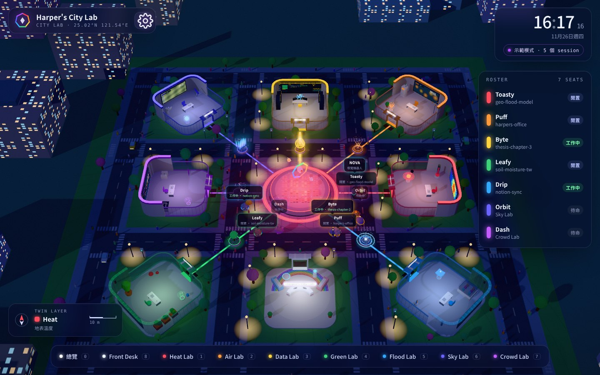

# Harper's Office

A 3D city-lab for [Claude Code](https://claude.com/claude-code), themed around GIS and urban climate research. Every Claude Code session you have open becomes one of seven original creature partners. They rush back to their lab while Claude is working, stop with a flashing yellow name tag when Claude needs you, and stroll around the plaza when idle.




```
/office        → opens the office in your browser
```

## Install

```bash
# inside Claude Code
/plugin marketplace add <your-github-user>/harpers-office
/plugin install harpers-office@harpers-office
```

Restart Claude Code (or start a new session) so the hooks load, then run `/office`.

## What you get

- **A tiny city campus on a 3×3 street grid.** In the centre is a 3D *digital twin* of the city on a map table. It cycles through seven GIS layers in rainbow order (heat, air, sensor network, green cover, flood depth, satellite, crowd density), and the ring around it breathes in the same colour.
- **Real day and night.** The sky, sun, shadows, street lamps and city windows follow your computer's clock: morning, sunset and a neon night.
- **Crowd flow on the streets.** Small pedestrians walk the street network like a crowd simulation, cars loop the outer road, and air-quality sensor poles change colour.
- **Seven labs + a Front Desk.** Each lab's door faces the plaza, and a coloured light path leads from the digital twin to the door with a moving nature sculpture on the street halfway.

  | # | Colour | Type | Partner | Lab | Street sculpture |
  |---|---|---|---|---|---|
  | 1 | red | HEAT | Toasty | Heat Lab | Flame |
  | 2 | orange | AIR | Puff | Air Lab | Tornado |
  | 3 | yellow | DATA | Byte | Data Lab (monitor wall, 3-screen on-call desk, server racks, topology hologram) | Lightning |
  | 4 | green | GREEN | Leafy | Green Lab | Fireflies |
  | 5 | blue | FLOOD | Drip | Flood Lab | Whirlpool |
  | 6 | indigo | SKY | Orbit | Sky Lab | Aurora |
  | 7 | violet | CROWD | Dash | Crowd Lab | Bird flock |

- **NOVA**, a guide bot, roams as an NPC.
- **HUD**: brand and settings (top-left), clock and connection status (top-right), roster (right), map legend with north arrow and the current twin layer (bottom-left), and lab navigation (bottom). Click a lab or a creature to fly the camera there and open its card.
- **Settings**: rename the company, labs and partners. Saved only in your browser's localStorage.
- **Accessible**: works at phone widths, full keyboard control (`1`–`7` labs, `8` Front Desk, `0`/`Esc` overview, arrow keys in the nav bar), and honours *Reduce motion*.

All characters and designs are original.

## How sessions are tracked

The plugin registers command hooks for `SessionStart`, `UserPromptSubmit`, `PreToolUse`, `PostToolUse`, `Notification`, `Stop` and `SessionEnd`. Each runs `scripts/office-hook.sh`, which rewrites `~/.claude/lets-office/roster.js`.

| Event | Status |
|---|---|
| `SessionStart`, `Stop` | idle |
| `UserPromptSubmit`, `PreToolUse`, `PostToolUse` | working |
| `PreToolUse` for `AskUserQuestion` | waiting for you |
| `Notification` of type `permission_prompt` / `elicitation_dialog` | waiting for you |
| `Notification` of type `idle_prompt` | ignored (not counted as waiting) |
| `SessionEnd` | removed |

**Privacy:** only the session id, the project folder name, the status, the Claude Code process id and two timestamps are stored. Prompt text, tool inputs and outputs are never written anywhere. Sessions whose process has exited are pruned automatically.

The page polls `roster.js` every 2 seconds. Sessions are seated in the order they started: the N-th open session is manager N (up to seven; extras are listed as waiting for a seat).

## Requirements

- macOS, Linux, or Windows with WSL / Git Bash (the hook is a POSIX `bash` script; `jq` or `python3` is used if available, with a `sed` fallback)
- A browser with WebGL 2

## Preview without Claude Code

Open `office/index.html?demo` in a browser to see the office with simulated sessions. Add `&hour=21` to preview a different time of day.

## Layout

```
.claude-plugin/plugin.json        plugin manifest
.claude-plugin/marketplace.json   lets people add this repo as a marketplace
hooks/hooks.json                  the seven command hooks
scripts/office-hook.sh            writes ~/.claude/lets-office/roster.js
scripts/open-office.sh            used by /office
commands/office.md                the /office slash command
office/index.html                 the whole office — one self-contained file (three.js bundled in)
```

## Editing the office

`office/index.html` is generated. Edit the sources in `dev/` and rebuild:

```bash
cd dev && npm install && npm run build
```

## Credits

Inspired by **[Let's Claude Office](https://www.letswrite.tw/lets-claude-office/)** by August ([Let's Write](https://www.letswrite.tw/)), which first turned Claude Code sessions into a 3D office using hooks and a polled `roster.js` ([source](https://github.com/letswritetw/letswrite-claude-office)). Harper's Office keeps the same idea and the same `~/.claude/lets-office` data folder, with a new theme, characters and code.

## License

MIT. Bundles [three.js](https://threejs.org) (MIT).
